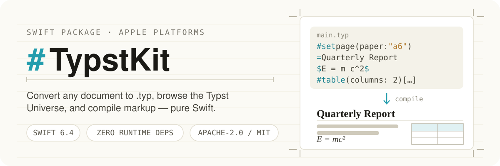
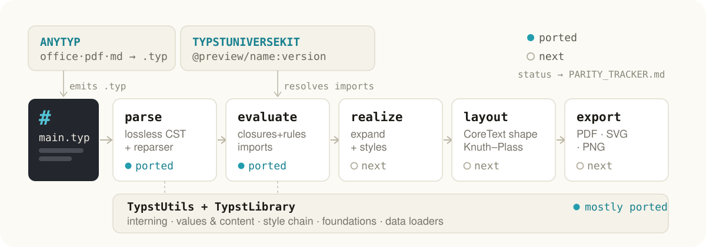
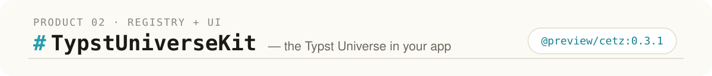
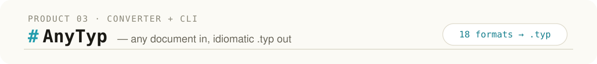

<p align="center">
  
</p>

<p align="center">
  <a href="https://swift.org"></a>
  <a href="https://swift.org/package-manager/"></a>
  <a href="https://developer.apple.com/ios/"></a>
  <a href="https://developer.apple.com/macos/"></a>
  <a href="https://developer.apple.com/visionos/"></a>
  <a href="LICENSE"></a>
</p>

<p align="center">
  <a href="#the-compiler-in-swift">Compiler port</a> ·
  <a href="#typstuniversekit">TypstUniverseKit</a> ·
  <a href="#anytyp">AnyTyp</a> ·
  <a href="#installation">Install</a> ·
  <a href="#testing">Testing</a> ·
  <a href="#roadmap--limits">Roadmap</a>
</p>

**TypstKit** is the Typst ecosystem for Apple platforms in one Swift package — no Rust toolchain, no WASM, no third-party runtime dependencies:

| Product | What it is | Status |
|---|---|---|
| `TypstKit` | Native Swift port of the [Typst](https://github.com/typst/typst) typesetting system (`TypstUtils` · `TypstSyntax` · `TypstLibrary`) | Parser + evaluator ported; realize/layout next → [PARITY_TRACKER.md](PARITY_TRACKER.md) |
| `TypstUniverseKit` | [Typst Universe](https://packages.typst.org) registry client + turnkey SwiftUI browser | Feature-complete: sync, search, secure downloads, `typst init` scaffolding |
| `AnyTyp` | Any document → idiomatic `.typ`, plus the `anytyp` CLI | Pure-Swift engine, 18 input formats |

- **Zero runtime third-party dependencies.** Foundation, URLSession, ImageIO, CoreText, and pure-Swift gzip/TAR/TOML only. (The Swift-DocC plugin is build tooling, never linked into products.)
- **Secure by default.** Tar-slip, symlink, and decompression-bomb guards; HTTPS-only; atomic installs; zero-tracking privacy manifest.
- **Offline-first.** Stale-while-revalidate catalog sync (ETag / `If-None-Match`); document conversion is fully local and App-Sandbox safe.
- **Strict Swift 6.** `Sendable` models, actor-isolated caches, `@Observable` UI, zero warnings.

## How it fits together

<p align="center">
  
</p>

AnyTyp produces `.typ` sources, TypstUniverseKit supplies the `@preview` packages they import, and the compiler port turns markup into documents — one dependency direction, no Rust in between.

<a id="the-compiler-in-swift"></a>
<p align="center">
  
</p>

A faithful Swift rewrite of `typst/typst` (Apache-2.0). The port mirrors upstream's architecture and test corpus rather than wrapping it — see [ARCHITECTURE.md](ARCHITECTURE.md) for the design and [PARITY_TRACKER.md](PARITY_TRACKER.md) for file-level status.

**Ported and tested:**

- **Lossless concrete syntax tree** — `Source`, `Span`/`FileId`, full `SyntaxKind`, lexer for markup/code/math modes, error-recovering parser, and the incremental reparser.
- **AST + tooling foundations** — ~70 typed node accessors, operator precedence tables, syntax highlighting (`highlight`/`highlightHTML`), `PackageSpec`/`typst.toml` models.
- **Evaluation engine** — all 13 upstream eval files: the Vm, scopes, closures, set/show rules, control flow, imports/module system, and math evaluation (currently inside `TypstLibrary`).
- **Value & content model** — the full `Value` enum, `Content` element trees, `StyleChain`, and most foundations scopes (`calc`, `str`, `array`, `dict`, `int`/`float`/`decimal`, `bytes`, `symbol`, `datetime`, `version`, …) plus JSON/YAML/TOML/XML/CBOR/CSV loaders.
- **Upstream corpus parity** — vendored syntax suite (10 files, 38 sections) where every emitted diagnostic matches upstream annotations exactly: kind, byte range, and message.

**Next:** `TypstRealize` → `TypstLayout` (CoreText shaping, Knuth-Plass line breaking) → `TypstExport` (PDF/SVG/raster/HTML) → `TypstIDE`. The compiler API is pre-release and will move as layout lands.

<a id="typstuniversekit"></a>
<p align="center">
  
</p>

The entire [Typst Universe](https://packages.typst.org) — thousands of templates, CVs, theses, presentations, and drawing libraries — inside native macOS, iOS, iPadOS, and visionOS apps. Pick a lane:

| Lane | Modules | For |
|---|---|---|
| **Headless** | `TypstUniverseCore` + `TypstUniverseStorage` | Custom editors, IDE builders, server-side Swift, enterprise tooling |
| **Turnkey UI** | + `TypstUniverseUI` | Any SwiftUI app that wants a Pages-style template chooser in minutes |

### Quick start: template picker in ~15 lines

```swift
import SwiftUI
import TypstUniverseStorage
import TypstUniverseUI

struct NewDocumentSheet: View {
    @Environment(\.dismiss) private var dismiss

    var body: some View {
        TemplatePickerSheet(
            client: .shared,
            initialCategory: .cv,
            destinationProvider: { spec in
                FileManager.default.temporaryDirectory
                    .appending(path: "\(spec.name)-\(UUID().uuidString)")
            }
        ) { project in
            print("Ready to open: \(project.entrypointURL)")
            dismiss()
        }
    }
}
```

The user browses, picks **Use Template**, and your completion handler receives a `ScaffoldedTemplateProject` (destination root, entrypoint file, created files, source spec).

### Headless usage

```swift
import TypstUniverseCore
import TypstUniverseStorage

// 1. Sync the catalog (cached instantly, revalidated via ETag in the background)
let universe = TypstUniverseClient.shared
let catalog = try await universe.syncCatalog()

// 2. Search & filter locally — no network, MainActor never blocked
let results = await universe.search(UniverseQuery(
    text: "thesis",
    kind: .templatesOnly,
    categories: [.thesis, .paper],
    disciplines: [.computerScience],
    compatibleWithCompiler: SemanticVersion(0, 14, 0),
    sort: .recentlyUpdated
))

// 3. Download + scaffold a template into a project folder (like `typst init`)
let spec = PackageSpec(namespace: .preview, name: "basic-resume", version: SemanticVersion(0, 2, 8))
let project = try await universe.scaffoldTemplate(spec, to: newDocumentFolderURL)
```

```swift
package.importSnippet()   // #import "@preview/cetz:0.3.1": *
package.initCommand()     // typst init @preview/cetz:0.3.1

for await event in await universe.fetch(spec) {          // queued → downloading → extracting → installed
    if case let .downloading(p) = event { progressView.progress = p }
}

let files: [String: Data] = try await universe.scaffoldInMemory(spec)   // FileWrapper/SwiftData hosts
let cvs = CuratedCollection.presets[1].packages(in: catalog)            // curated storefront sections
let official = CuratedCollection.officialTemplates.packages(in: catalog)
```

Point `TypstUniverseClient.live(configuration:)` at a private registry or merge `@local` packages for enterprise use.

### Customizing the UI

```swift
TypstUniverseBrowserView(model: model)
    .typstUniverseConfiguration(.init(lockedKind: .templatesOnly))
    .onTemplateSelected { package, version in analytics.track(package.name) }
    .onTemplateScaffolded { project in store.open(project) }
    .onPackageImportCopied { snippet in toast("Copied") }
```

- `.typstUniverseConfiguration(_:)` — lock to templates-only, pre-select a category, set accent color, hide the import snippet.
- `.onTemplateSelected` / `.onTemplateScaffolded` / `.onPackageImportCopied` — observe without forking the views.
- `TypstLivePreviewProviding` — inject your own renderer next to the static WebP preview.
- Every card, chip, picker, and progress indicator carries VoiceOver labels, scales with Dynamic Type (including Accessibility sizes), respects Reduce Motion and Increased Contrast, and mirrors for RTL layouts.

For fully custom layouts, compose the primitives directly: `TemplateCardView`, `CategoryPill`, `VersionBadge`, `ImportCopyButton`, `PackageDetailView`, `CategorySidebarView`, `PackageGridView`.

### Architecture

```
┌─ TypstUniverseCore (Foundation only, Apple platforms) ──────────┐
│ Models: SemanticVersion, UniverseCategory (19),                 │
│   UniverseDiscipline, PackageSpec, UniversePackage,             │
│   TypstManifest, CuratedCollection, TypstUniverseError          │
│ Registry: TypstRegistryProvider, OfficialUniverseRegistry       │
│   (ETag), IndexDecoder, VersionGrouper                          │
│ Search: UniverseQuery, UniverseSearchEngine (facets + sort)     │
│ Parsing: TypstTomlParser (pure Swift, typst.toml only)          │
└──────────────────────────────┬──────────────────────────────────┘
                               │ depends on
┌─ TypstUniverseStorage ───────▼──────────────────────────────────┐
│ SecureTarGzExtractor (pure-Swift gzip + USTAR, security-first)  │
│ PackageCacheManager (actor: dedup, atomic install, LRU cap)     │
│ TemplateScaffolder (typst init: disk + in-memory)               │
│ LocalNamespaceScanner (@local merge) · TypstUniverseClient      │
└──────────────────────────────┬──────────────────────────────────┘
                               │ depends on
┌─ TypstUniverseUI (SwiftUI, iOS/macOS/visionOS 27+) ─────────────┐
│ UniverseBrowserModel (@Observable state machine)               │
│ ThumbnailPipeline (NSCache + disk, ImageIO WebP off-main)       │
│ TypstUniverseBrowserView · TemplatePickerSheet                 │
│ PackageDetailView · cards, pills, badges                        │
└─────────────────────────────────────────────────────────────────┘
```

Upstream contracts (no scraping, no API keys): `…/preview/index.json` (ETag-cached) → `{name}-{version}.tar.gz` (immutable, cached) → `thumbnails/{name}-{version}[-small].webp` → `typst.toml` `[package]`/`[template]` tables. Unknown JSON fields, future categories/disciplines, and malformed dates degrade gracefully instead of failing the catalog load.

### Security

Community tarballs are untrusted input — the extractor treats them that way:

- Rejects `..` components, absolute paths, null bytes, backslashes, drive-letter paths, and over-deep paths (default max depth 32).
- Rejects symlinks, hardlinks, device nodes, and FIFOs outright.
- Enforces ceilings (defaults: 100 MB uncompressed, 5,000 files) against decompression bombs.
- Installs atomically via a unique staging directory + rename, so interrupted downloads never corrupt the cache.
- HTTPS-only archive URLs; zero tracking, zero collected data ([PrivacyInfo](Sources/TypstUniverseUI/Resources/PrivacyInfo.xcprivacy)).

The full threat model lives in the DocC article [“Archive Security”](Sources/TypstUniverseCore/Documentation.docc/Security.md). See [`Examples/UniverseExplorerApp`](Examples/UniverseExplorerApp) for a complete browser + “New from Template” flow on macOS, iOS, iPadOS, and visionOS.

<a id="anytyp"></a>
<p align="center">
  
</p>

A pure-Swift conversion engine — OLE/ZIP/XML readers, per-format parsers, one information-preserving `Document` model, and a single Typst serializer with OMML/MathML/LaTeX math translation. Content-byte detection, no network, App-Sandbox safe.

**18 input formats:** `doc` `docx` `odt` `pdf` `ppt` `pptx` `rtf` `epub` `xlsx` `ods` `odp` `csv` `tsv` `md` `html` `tex` `json` `txt` — with extension aliases (`docm`, `xls`, `ppsx`, `markdown`, `latex`, `htm`, …) resolving to the same parsers.

```swift
import AnyTyp

// File URL, in-memory Data, sync or non-blocking @concurrent:
let typst = try await AnyTyp.convertAsync(
    fileURL,
    options: AnyTypOptions(
        standalone: true,                 // prepend #set page / #set par
        title: "Quarterly Report",        // emits #set document(title:)
        extractAssetsTo: assetsDirectoryURL  // embedded images → #image("...")
    )
)

let fromCSV = try AnyTyp.convert(csvData, format: .csv)
let doc = try await AnyTyp.parseDocumentAsync(docxData)   // structured document AST
```

```bash
# CLI (same engine, exit codes 0/1/2/3 — 3 = PDF needs OCR)
swift run AnyTypCLI report.docx -o report.typ
swift run AnyTypCLI slides.pptx -o slides.typ --assets-dir assets
swift run AnyTypCLI - --format csv < data.csv
```

Typst keeps what Markdown drops: merged table cells, multi-row headers, roman/offset enum numbering, footnotes, cross-references, and native math — all verified against the package's own Typst syntax parser.

## Installation

### Swift Package Manager (`Package.swift`)

```swift
dependencies: [
    .package(url: "https://github.com/VM451/TypstKit", from: "1.0.0")
],
targets: [
    .target(name: "MyApp", dependencies: [
        .product(name: "TypstKit", package: "TypstKit"),             // compiler port
        .product(name: "TypstUniverseKit", package: "TypstKit"),     // registry + SwiftUI browser
        // Headless alternative: TypstUniverseCore and/or TypstUniverseStorage.
        .product(name: "AnyTyp", package: "TypstKit"),               // document → .typ
    ])
]
```

Only pay for what you use — each product is an independent library; `TypstUniverseCore` and `TypstUniverseStorage` are exported separately for headless hosts, while `TypstUniverseKit` bundles them with the SwiftUI browser.

### Xcode

1. **File → Add Package Dependencies…**
2. Enter `https://github.com/VM451/TypstKit`
3. Add the products you need to your target.

## Requirements

| | Minimum |
|---|---|
| Swift | 6.4+ (strict concurrency, `-strict-concurrency=complete`) |
| Xcode | 27+ (SwiftUI macros require the Xcode toolchain, not CLT alone) |
| iOS / iPadOS | 27.0+ |
| macOS | 27.0+ |
| visionOS | 27.0+ |

> Building from the command line? Use the Xcode toolchain:
> `DEVELOPER_DIR=/Applications/Xcode.app/Contents/Developer swift build`

## Testing

```bash
# Full suite (Xcode toolchain required for the SwiftUI target)
DEVELOPER_DIR=/Applications/Xcode.app/Contents/Developer swift test

# Narrow lanes
swift test --filter TypstUniverseCoreTests
swift test --filter TypstSyntaxTests
swift test --filter AnyTypTests
```

300+ tests across six suites: SemVer ordering, lenient index decoding, search ranking + facet intersection, TOML parsing, adversarial tar fixtures (traversal, absolute, symlink, depth, bad gzip), end-to-end scaffolding, ViewModel transitions, the vendored Typst syntax corpus with exact diagnostic parity, evaluator behavior, format loaders, and AnyTyp conversion fixtures. Verify locally with the Xcode 27 toolchain on macOS.

## Documentation

- This README for the fast path; [ARCHITECTURE.md](ARCHITECTURE.md) for the port design; [PARITY_TRACKER.md](PARITY_TRACKER.md) for compiler parity status.
- DocC catalogs in-source: `TypstUniverseCore/Documentation.docc` (Getting Started, Architecture, Archive Security, Searching), plus Storage and UI catalogs. Build in Xcode via **Product → Build Documentation**, or `swift package generate-documentation`.
- `Examples/UniverseExplorerApp` — a runnable multiplatform reference app.

## Roadmap & limits

- **Compiler port** — Phase 3 realize/layout, Phase 4 math/introspection/bibliography, Phase 5 exporters + incremental compile, Phase 6 IDE + `AnyTyp → compile → PDF` end-to-end (see [PARITY_TRACKER.md](PARITY_TRACKER.md)).
- **TypstUniverseKit v2.0 (if needed)** — SQLite/FTS5 backing store once the catalog exceeds ~25,000 entries; optional remote curated-collection feed.
- **Limits** — Apple platforms only (no Linux/Windows targets); the compiler port is pre-release, so documents cannot yet be rendered to PDF/SVG from this package (attach your own renderer via `TypstLivePreviewProviding`); no Typst Pro account APIs or package-submission automation.

## Contributing

PRs welcome. The gates: `swift build` with zero warnings, `swift test` green, no `print()` in library code (`KitLog` instead), no third-party runtime dependencies. See [AGENTS.md](AGENTS.md) for conventions, and treat untrusted-archive handling as security-sensitive — report extractor bypasses privately rather than as a public issue.

## License

Apache-2.0 — see [LICENSE](LICENSE). The `AnyTyp` subtree is MIT-licensed ([LICENSE-MIT](LICENSE-MIT)) and derives parser foundations from [`firecrawl/anydoc`](https://github.com/firecrawl/anydoc) — see [NOTICE](NOTICE) for attribution.
